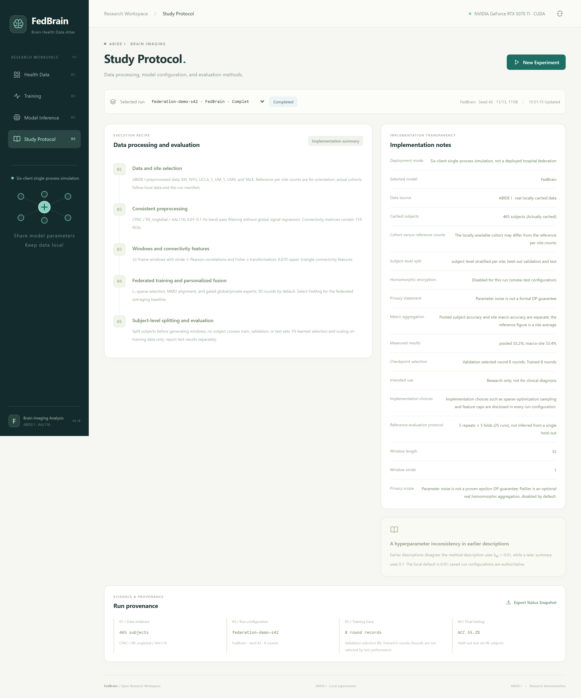

<!-- SPDX-License-Identifier: MIT -->
# FedBrain reproduction: six-site federated brain-network learning

This repository is a runnable reproduction of *FedBrain: A robust multi-site brain network
analysis framework based on federated learning for brain disease diagnosis*
(Neurocomputing 559 (2023) 126791, [DOI](https://doi.org/10.1016/j.neucom.2023.126791)). It
trains a six-client federated model on public ABIDE-I derivatives, records every client and
server event of a short demo run, and ships a browser interface that replays the recorded
trace and shows which data stay at each site and which tensors cross the federation boundary.

The paper reports 79% mean accuracy. **This implementation does not reproduce that result.**
Over seeds 42/43/44 the FedBrain configuration reaches 60.76% +/- 4.05 macro-site accuracy,
while a matched-mask, matched-noise FedAvg baseline reaches 63.69% +/- 3.19, higher than
FedBrain and in the opposite direction from the paper. Paper values and measured values are
always reported separately, and no hyperparameter or communication round was selected on the
test set.


## Contents

- [What this repository contains](#what-this-repository-contains)
- [Results at a glance](#results-at-a-glance)
- [Data](#data)
- [Quick start](#quick-start)
- [Reproduction protocol](#reproduction-protocol)
- [What the federation moves](#what-the-federation-moves)
- [Interface](#interface)
- [Repository layout](#repository-layout)
- [Compliance and license identifiers](#compliance-and-license-identifiers)
- [Verification](#verification)
- [Reference environment](#reference-environment)
- [Committed demo trace](#committed-demo-trace)
- [Documentation](#documentation)
- [Limitations and non-claims](#limitations-and-non-claims)
- [Data sources and citations](#data-sources-and-citations)
- [License](#license)

## What this repository contains

- `fedbrain/`: 12 modules covering ABIDE-I data handling, the FedBrain encoder and mixture of
  experts, the Eq. 11 sparse selection, federated training with per-round event recording,
  clipping and Laplace noise, Paillier arithmetic, health-data analytics, a read-only
  description of the recorded privacy state, and the FastAPI server.
- `web/`: a dependency-free English interface with four views (Health Data, Training, Model
  Inference, Study Protocol). No CDN, no client-side build step.
- `configs/`: run configurations for the smoke test, the main 50-round run, the demo trace,
  the standalone demo, the optimization study and encrypted aggregation.
- `scripts/`: the single cross-platform entry point `scripts/reproduce.py`, plus data and
  cache builders, audits, compliance checks, browser QA and packaging helpers.
- `docs/`: reproduction protocol, generated results, diagnostics, research log and the
  interface figures referenced below.
- `tests/`: offline unit, API and compliance tests.
- `runs/federation-demo-s42/`: the committed eight-round trace that the interface replays.
- `runs/encrypted-smoke-2048/`: the committed two-round record of the optional Paillier run
  (`result.json` and `split.json` only; no checkpoint or predictions).

## Results at a glance

Macro-site accuracy is the equal-weight mean of the six site accuracies; pooled accuracy is
computed over all test subjects combined. The two are reported separately and are not
interchangeable.

| Measurement | Result |
|---|---|
| Paper reference | 79% mean accuracy (paper-reported; not reproduced) |
| FedBrain, seeds 42/43/44 | macro-site mean 60.76% +/- 4.05 |
| Matched-mask, matched-noise FedAvg, same three seeds | macro-site mean 63.69% +/- 3.19 (higher than FedBrain) |
| Demo run, seed 42, 8 rounds, 96 test subjects | pooled 55.21%, macro-site 53.41%, AUC 0.738, sensitivity 0.128, specificity 0.959 |
| Two-round smoke run, 120 subjects | 54.17% (link check only, not a performance result) |
| Paillier 2048-bit versus plaintext, same configuration | max predicted-probability difference 9.69e-8 |
| Bounded optimization attempt | pooled +1.03 pp, 95% interval [-5.83, +7.89] pp, pre-registered gate not met |

The per-run table, site-level breakdowns and the independent validity checks are in
[docs/RESULTS.md](docs/RESULTS.md). The low test accuracy, the class imbalance and the sparse
optimization state are analysed in [docs/ACCURACY_DIAGNOSIS.md](docs/ACCURACY_DIAGNOSIS.md)
and [docs/SPARSE_CONVERGENCE.md](docs/SPARSE_CONVERGENCE.md).

## Data

The experiments use the public ABIDE-I PCP release with CPAC `filt_noglobal` preprocessing
and the AAL116 atlas: 465 subjects (241 HC / 224 ASD) across six sites, NYU 172, UM 88,
USM 67, UCLA 64, KKI 33 and YALE 41. Data are downloaded at runtime into `data/abide`, about
2 GB, and are never committed; the downloader records a SHA-256 for every downloaded
time-series file. The paper's subject list and full QC rule are not public, so the cohort
counts were not forced to match the paper's table; see [docs/RESULTS.md](docs/RESULTS.md).

## Quick start

Requirements: any Python 3.10+ interpreter available as `python` on PATH, git, network access
for the data step, and about 2 GB of free disk space. A CUDA build of PyTorch is optional;
CPU is supported. GNU make is optional.

Linux and macOS:

```bash
python scripts/reproduce.py setup
python scripts/reproduce.py data
python scripts/reproduce.py features
python scripts/reproduce.py demo
python scripts/reproduce.py test
python scripts/reproduce.py verify
python scripts/reproduce.py serve --port 8765
```

The first command creates `.venv/` and installs `requirements.txt`; later commands detect and
reuse that environment automatically, so no activation step is required. The final command
serves the interface at http://127.0.0.1:8765. To run everything except the server in one
call, use `python scripts/reproduce.py all` in place of the middle steps.

Windows, relative paths only (cmd.exe or PowerShell):

On Windows, confirm the interpreter first: `python --version` must print a version. If it
opens the Microsoft Store or prints nothing, `python` on PATH is the Store alias; use the
full path to a real interpreter instead, for example
`"%LOCALAPPDATA%\Programs\Python\Python312\python.exe" scripts\reproduce.py setup`, and replace `python` with that
path in the commands below.

```bat
python scripts\reproduce.py setup
.\.venv\Scripts\python.exe scripts\reproduce.py data
.\.venv\Scripts\python.exe scripts\reproduce.py features
.\.venv\Scripts\python.exe scripts\reproduce.py demo
.\.venv\Scripts\python.exe scripts\reproduce.py test
.\.venv\Scripts\python.exe scripts\reproduce.py verify
.\.venv\Scripts\python.exe scripts\reproduce.py serve --port 8765
```

PowerShell is not required. `setup.ps1` and `start.ps1` are optional convenience wrappers
around the same setup and serve steps; the canonical path is `scripts/reproduce.py`.

On systems with GNU make, the same steps are available as targets:

```bash
make setup
make reproduce
make serve
```

`make reproduce` is equivalent to `python scripts/reproduce.py all`. The individual targets
`make data`, `make demo`, `make test`, `make verify` and `make compliance` map to the
corresponding steps.

The low-level module forms are equivalent, but they are not the primary path:

```bash
python -m fedbrain.runner download
python -m fedbrain.runner train --config configs/federation_demo.json --run-id federation-demo-s42
python -m fedbrain.server --port 8765
python -m unittest discover -s tests -q
python scripts/check_no_chinese.py
python scripts/check_compliance.py
```

## Reproduction protocol

[docs/REPRODUCTION.md](docs/REPRODUCTION.md) is the canonical protocol: requirements,
platform notes, the exact commands, generated artifacts, the committed-trace caveat and
troubleshooting. The quick start above is its short form. In order, the steps are:
environment setup, public data download, health-view cache build, demo trace training, the
offline test suite, the verification bundle (compliance, English-only scan, tests, and the
health-data independence check when data are present), then the interface server. All
commands run from the repository root.

## What the federation moves

Six clients run in a single Python process. The model has a shared encoder and global head;
each site additionally holds a private expert head and gate. The demo trace records eight
rounds on the 465-subject cohort (292 train, 77 validation and 96 test subjects).

| Stays at the site | Crosses the boundary | At the aggregator |
|---|---|---|
| Raw BOLD time series | Shared encoder and global head: 4113 parameters (16452 bytes pre-encryption) | Six uploads per round, combined by a uniform mean |
| 116x116 individual functional connectivity | Alignment statistics: marginal mean, class means and class-window counts, in plaintext | Aggregate statistics only; no per-subject values |
| Subject labels | Optional Paillier ciphertext of the shared vector when homomorphic aggregation is enabled | The coordinator holds the decryption key in the same process |
| Private expert head and gate: 18 private parameters per site | Nothing from the private blocks | Private blocks are never uploaded or aggregated |

In the committed trace all six private blocks are verified unchanged after aggregation
(`private_preserved = true`), the aggregation arithmetic error is 0.0, and the equal-mean
replay maximum error is 2.98e-8. The interface derives its numbers from the recorded trace;
where a value was not recorded it reports that state instead of inventing one.

## Interface

Four English views:

| View | Content |
|---|---|
| Health Data | 116x116 group FC heatmap, 116-ROI connectivity ring, HC/ASD/descriptive difference views, cohort composition by site, age distribution, individual BOLD series with a leave-one-out HC reference, and the federated data-flow figure |
| Training | Run configuration, loss and accuracy history for the selected run, per-site progress, and the recorded federation replay (client updates, parameter sketch, projection of fixed training probes) |
| Model Inference | Per-subject connectivity and the model output for a completed run |
| Study Protocol | Processing steps, implementation transparency, paper reference, evidence and provenance |

Health-data views read the public ABIDE derivatives through the health-data cache and do not
load a model checkpoint. The interface is English-only (see
[docs/UI_LANGUAGE.md](docs/UI_LANGUAGE.md)).

<p align="center">
  
  
</p>

## Repository layout

```text
fedbrain/                  library and service (12 modules)
  data.py                  ABIDE download, QC, FC/BOLD features, fixed windows
  model.py                 encoder, mixture-of-experts heads, gates, alignment
  sparse.py                Eq. 11 proximal sparse selection
  selection.py             validation-only checkpoint selection
  federation.py            client/server loop and per-round event recording
  privacy.py               clipping, Laplace noise, Paillier packing
  runner.py                download/train command line and run bookkeeping
  metrics.py               pooled and macro-site metrics
  health_data.py           FC/BOLD cache for the health views
  protection.py            read-only description of the recorded privacy state
  server.py                FastAPI application and static interface
  __init__.py              package metadata

web/                       dependency-free interface (no CDN)
  index.html               four views
  i18n.js                  presentation guard for non-English payloads
  app.js                   navigation, training, inference, protocol
  health.js                health-data atlas
  protection.js            federated data-flow figure
  federation.js            recorded-round replay
  *.css                    layout and view styles

configs/                   run configurations (smoke, main, demo, standalone demo, optimized, encrypted)
scripts/                   reproduce.py entry point, data build, audits, compliance, QA, packaging
                           (includes check_compliance.py and add_spdx_headers.py)
docs/                      reproduction protocol, results, diagnostics, research log, images/
tests/                     offline unit, API and compliance tests, 91 tests (includes the compliance and portability suites)
runs/federation-demo-s42/  committed eight-round trace replayed by the interface
runs/encrypted-smoke-2048/ committed two-round record of the optional Paillier run
Makefile                   make targets that delegate to scripts/reproduce.py
setup.sh                   POSIX convenience wrapper (optional)
setup.ps1, start.ps1       PowerShell convenience wrappers (optional)
pyproject.toml             project metadata and dependencies
requirements.txt           runtime dependencies
LICENSE, LICENSES/MIT.txt  MIT license text
REUSE.toml                 license annotations for JSON records and images
CITATION.cff               citation metadata
```

## Compliance and license identifiers

- Every source file carries an SPDX identifier (`SPDX-License-Identifier: MIT`) in its first
  lines.
- `LICENSE` and `LICENSES/MIT.txt` ship with the repository.
- `scripts/check_compliance.py` enforces the SPDX identifier, verifies that non-commentable
  files are covered by `REUSE.toml`, rejects Windows absolute paths and macOS/Linux home
  paths in tracked files, checks that committed run records store project-relative
  directories, and checks that `pyproject.toml` dependencies match `requirements.txt`.
- `scripts/add_spdx_headers.py` adds the identifier to tracked source files that can hold a
  comment; it is idempotent and skips files covered by `REUSE.toml`.
- `tests/test_compliance.py` covers these rules.
- `REUSE.toml` covers the files that cannot carry a comment header: JSON records, run records
  and PNG images.

Run `python scripts/reproduce.py verify` to execute the full compliance and verification
bundle, or `python scripts/check_compliance.py` for the license and portability checks alone.

## Verification

```bash
python scripts/reproduce.py test
python scripts/reproduce.py verify
python scripts/check_no_chinese.py
python scripts/check_compliance.py
python -m unittest discover -s tests -q
```

`verify` runs the compliance check, the English-only scan, the test suite and, when
`data/abide/manifest.json` is present, the health-data independence check. The test suite
covers FC and Fisher-z correctness, window construction, cache invalidation, subject-level
splits without leakage, sparse proximal accuracy, mixture-of-experts gating, alignment
distances, real Paillier arithmetic, API input validation, private-expert snapshot
preservation, validation-only checkpoint selection, test-set API lockout, per-site data
independence, the honesty rules for unrecorded interface values, and the compliance checks.
Two positive controls guard the metric itself: a scorer fed ground truth scores 1.0, and
10000 label permutations score 0.501.

## Reference environment

The recorded results were produced on Python 3.10+, torch 2.11.0+cu128, CUDA 12.8 and an
NVIDIA RTX 5070 Ti with 16 GB of memory. Linux, macOS and Windows are supported. A CPU-only
PyTorch build works; the interface and the health-data views do not require a GPU.

## Committed demo trace

`runs/federation-demo-s42/` contains `result.json`, `split.json` and
`federation/index.json` with `federation/round-0001.json` through `round-0008.json`. The
committed records store portable, project-relative directories (`data/abide` and `runs`),
not machine-specific absolute paths.

A fresh clone that runs `python scripts/reproduce.py demo` uses
`configs/federation_demo_standalone.json`, because the committed trace reused the sparse
selection from `full-fedbrain-s42`, which is not distributed; the standalone configuration
fits the selection instead of reusing it. Both paths were executed on the reference machine:
the reuse path and the fit path each reproduced the committed metrics exactly (pooled
55.21%, macro-site 53.41%, AUC 0.738, sensitivity 0.128, specificity 0.959). Bit-identical
values across different CPUs, BLAS builds or PyTorch versions are not claimed.

## Documentation

- [docs/REPRODUCTION.md](docs/REPRODUCTION.md): canonical reproduction protocol.
- [docs/RESULTS.md](docs/RESULTS.md): measurements generated from real `result.json` files.
- [docs/ACCURACY_DIAGNOSIS.md](docs/ACCURACY_DIAGNOSIS.md): read-only diagnosis of the low
  test accuracy.
- [docs/SPARSE_CONVERGENCE.md](docs/SPARSE_CONVERGENCE.md): Eq. 11 speed-up and training-set
  convergence diagnosis.
- [docs/FEDERATED_DATA_PROTECTION.md](docs/FEDERATED_DATA_PROTECTION.md): data-protection
  view semantics and scope.
- [docs/HEALTH_DATA_VIEW.md](docs/HEALTH_DATA_VIEW.md): health-data definitions and usage.
- [docs/UI_LANGUAGE.md](docs/UI_LANGUAGE.md): English-only repository policy and checks.
- [docs/EXPERIMENT_PLAN.md](docs/EXPERIMENT_PLAN.md): pre-registration and validity gates.
- [docs/PUBLISH.md](docs/PUBLISH.md): publishing notes for this repository.

## Limitations and non-claims

- **Single process, one machine.** The six clients are simulated in one Python process over
  centrally stored public data. This is not a deployed hospital federation, and no network
  isolation is demonstrated.
- **Not differential privacy.** `noise_scale = 0.01` is a Laplace scale `b = 0.01`, not an
  epsilon from an accounting procedure. No certified epsilon-DP guarantee is claimed.
- **Paillier is arithmetic, not a security boundary.** Ciphertext addition is real, but the
  coordinator holds the key in the same process and broadcasts the aggregated model in
  plaintext.
- **Alignment statistics are plaintext.** Marginal means, class means and class-window
  counts are not covered by the parameter noise or by the Paillier path.
- **The paper's 79% is not reproduced.** The measured macro-site mean is 60.76% +/- 4.05,
  and the matched FedAvg baseline is higher at 63.69% +/- 3.19.
- **Cohort differs from the paper.** The paper's subject list and full QC rule are not
  public, so counts were not forced to match the paper's table.
- **The eight-round demo is a process demonstration.** It exists to show the recorded
  client/upload/aggregate/broadcast sequence and is not the 50-round performance experiment.
- **Research use only.** HC and ASD are the source dataset's research labels; this is not a
  diagnostic device.

## Data sources and citations

ABIDE-I PCP derivatives (CPAC `filt_noglobal`, AAL116) come from the public
[FCP-INDI](https://fcp-indi.github.io/) release and are downloaded at runtime. No subject
imaging data are redistributed; the committed trace contains aggregate metrics, the subject
split and the federation trace, but no subject-level images.

```bibtex
@article{zhang2023fedbrain,
  title   = {FedBrain: A robust multi-site brain network analysis framework based on
             federated learning for brain disease diagnosis},
  author  = {Zhang, Chang and others},
  journal = {Neurocomputing},
  volume  = {559},
  pages   = {126791},
  year    = {2023},
  doi     = {10.1016/j.neucom.2023.126791}
}

@article{dimartino2014abide,
  title   = {The autism brain imaging data exchange: towards a large-scale evaluation of
             the intrinsic brain architecture in autism},
  author  = {Di Martino, Adriana and others},
  journal = {Molecular Psychiatry},
  volume  = {19},
  number  = {6},
  pages   = {659--667},
  year    = {2014}
}
```

## License

The code in this repository is released under the [MIT License](LICENSE). ABIDE and CPAC
data keep their own terms from FCP-INDI and are not covered by the MIT license. The article
text is not redistributed.
