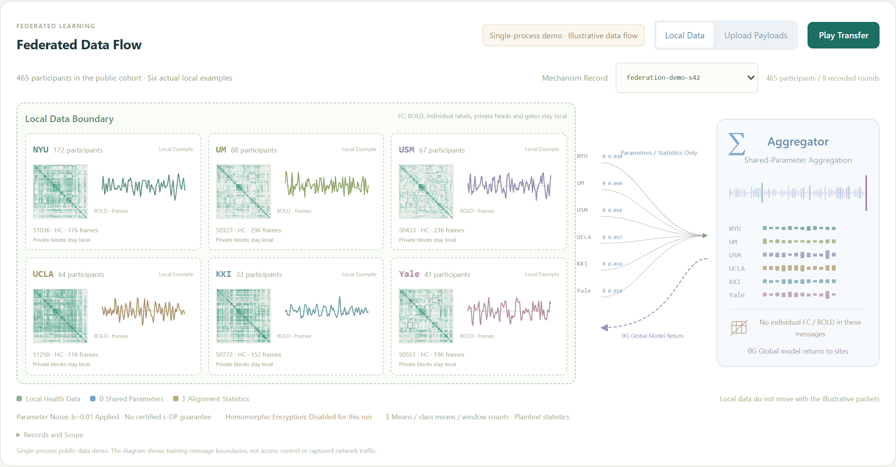

<!-- SPDX-License-Identifier: MIT -->
# FedBrain — federated learning for multi-site brain-network analysis

A six-site federated learning system for brain-network analysis on public ABIDE-I
derivatives. It trains a shared encoder with per-site private experts and gates, records
every client and server event of a short run, and ships a browser interface that replays the
recorded trace and shows which data stay at each site and which tensors cross the federation
boundary.

The system is maintained by this group as an independent implementation. Methodological
background and the group's federated publications are collected in
[docs/RELATED_WORK.md](docs/RELATED_WORK.md).



## Contents

- [What this system does](#what-this-system-does)
- [Results at a glance](#results-at-a-glance)
- [Data](#data)
- [Quick start](#quick-start)
- [Pipeline steps](#pipeline-steps)
- [What the federation moves](#what-the-federation-moves)
- [Interface](#interface)
- [Repository layout](#repository-layout)
- [Compliance and license identifiers](#compliance-and-license-identifiers)
- [Verification](#verification)
- [Reference environment](#reference-environment)
- [Committed demo trace](#committed-demo-trace)
- [Related federated work](#related-federated-work)
- [Documentation](#documentation)
- [Limitations and non-claims](#limitations-and-non-claims)
- [Data sources](#data-sources)
- [License](#license)

## What this system does

- Trains a six-client federated model: one client per acquisition site, each with a private
  expert head and a gating network, plus a shared encoder and global head that are the only
  parameters exchanged with the aggregator.
- Applies a sparse connection selection before classification, aligns site distributions
  through marginal and class-conditional hidden means, and perturbs the shared vector with
  clipping and Laplace noise. Paillier aggregation is available as an option.
- Records a full per-round trace: per-client uploads, aggregation, broadcast, private-block
  preservation checks and the alignment statistics that were exchanged.
- Serves a dependency-free browser interface with four views, driven entirely by recorded
  results; where a value was not recorded the interface says so instead of inventing one.

## Results at a glance

Macro-site accuracy is the equal-weight mean of the six site accuracies; pooled accuracy is
computed over all test subjects combined. The two are reported separately and are not
interchangeable. Every value below is produced by this system.

| Measurement | Value |
|---|---|
| FedBrain configuration, seeds 42/43/44 | macro-site mean 60.76% +/- 4.05 |
| Matched-mask, matched-noise FedAvg, same three seeds | macro-site mean 63.69% +/- 3.19 |
| Demo run, seed 42, 8 rounds, 96 test subjects | pooled 55.21%, macro-site 53.41%, AUC 0.738, sensitivity 0.128, specificity 0.959 |
| Two-round smoke run, 120 subjects | 54.17% (pipeline link check only, not a performance result) |
| Paillier 2048-bit versus plaintext, same configuration | max predicted-probability difference 9.69e-8 |
| Bounded optimization attempt | pooled +1.03 pp, 95% interval [-5.83, +7.89] pp, pre-registered gate not met |

Per-run tables, site-level breakdowns and the independent validity checks are in
[docs/RESULTS.md](docs/RESULTS.md). The low test accuracy, the class imbalance and the sparse
selection state are analysed in [docs/ACCURACY_DIAGNOSIS.md](docs/ACCURACY_DIAGNOSIS.md) and
[docs/SPARSE_CONVERGENCE.md](docs/SPARSE_CONVERGENCE.md).

## Data

The experiments use the public ABIDE-I PCP release with CPAC `filt_noglobal` preprocessing
and the AAL116 atlas: 465 subjects (241 HC / 224 ASD) across six sites — NYU 172, UM 88,
USM 67, UCLA 64, KKI 33 and YALE 41. Data are downloaded at runtime into `data/abide`, about
2 GB, and are never committed; the downloader records a SHA-256 for every downloaded
time-series file.

The cohort is every available subject that passes the public quality filter. Published
per-site counts differ because subject identifiers and quality thresholds are not available,
so counts are not forced to match them; see [docs/RESULTS.md](docs/RESULTS.md).

## Quick start

Requirements: any Python 3.10+ interpreter available as `python` on PATH, git, network access
for the data step, and about 2 GB of free disk space. A CUDA build of PyTorch is optional;
CPU is supported. GNU make is optional.

Linux and macOS:

```bash
python scripts/pipeline.py setup
python scripts/pipeline.py data
python scripts/pipeline.py features
python scripts/pipeline.py demo
python scripts/pipeline.py test
python scripts/pipeline.py verify
python scripts/pipeline.py serve --port 8765
```

The first command creates `.venv/` and installs `requirements.txt`; later commands detect and
reuse that environment automatically, so no activation step is required. The final command
serves the interface at http://127.0.0.1:8765. To run everything except the server in one
call, use `python scripts/pipeline.py all` in place of the middle steps.

Windows, relative paths only (cmd.exe or PowerShell):

On Windows, confirm the interpreter first: `python --version` must print a version. If it
opens the Microsoft Store or prints nothing, `python` on PATH is the Store alias; use the
full path to a real interpreter instead, for example
`"%LOCALAPPDATA%\Programs\Python\Python312\python.exe" scripts\pipeline.py setup`, and replace `python` with that
path in the commands below.

```bat
python scripts\pipeline.py setup
.\.venv\Scripts\python.exe scripts\pipeline.py data
.\.venv\Scripts\python.exe scripts\pipeline.py features
.\.venv\Scripts\python.exe scripts\pipeline.py demo
.\.venv\Scripts\python.exe scripts\pipeline.py test
.\.venv\Scripts\python.exe scripts\pipeline.py verify
.\.venv\Scripts\python.exe scripts\pipeline.py serve --port 8765
```

PowerShell is not required. `setup.ps1` and `start.ps1` are optional convenience wrappers
around the same setup and serve steps; the canonical path is `scripts/pipeline.py`.

On systems with GNU make, the same steps are available as targets:

```bash
make setup
make pipeline
make serve
```

`make pipeline` is equivalent to `python scripts/pipeline.py all`. The individual targets
`make data`, `make demo`, `make test`, `make verify` and `make compliance` map to the
corresponding steps.

The low-level module forms are equivalent, but they are not the primary path:

```bash
python -m fedbrain.runner download
python -m fedbrain.runner train --config configs/federation_demo.json --run-id federation-demo-s42
python -m fedbrain.server --port 8765
python -m unittest discover -s tests -q
python scripts/check_no_chinese.py
python scripts/check_compliance.py
```

## Pipeline steps

[docs/PIPELINE.md](docs/PIPELINE.md) is the full execution protocol: requirements, platform
notes, exact commands, generated artifacts, expected timings, the committed-trace caveat and
troubleshooting. The quick start above is its short form.

| Step | Command | Writes | Typical duration |
|---|---|---|---|
| Environment | `python scripts/pipeline.py setup` | `.venv/` | 2-10 min depending on the wheel cache |
| Public data | `python scripts/pipeline.py data` | `data/abide/` with `manifest.json` | 6 s when the cache is warm, longer on a fresh download |
| Health-view cache | `python scripts/pipeline.py features` | `artifacts/health_data/raw-fc-v1.npz` | about 1 s warm |
| Demo trace | `python scripts/pipeline.py demo` | `runs/demo-run/` | about 30 s |
| Tests | `python scripts/pipeline.py test` | - | about 11 s |
| Verification | `python scripts/pipeline.py verify` | prints a report | about 15 s |
| Interface | `python scripts/pipeline.py serve --port 8765` | serves `web/` and the API | runs until stopped |

## What the federation moves

Six clients run in a single Python process. The model has a shared encoder and global head;
each site additionally holds a private expert head and gate. The demo trace records eight
rounds on the 465-subject cohort (292 train, 77 validation and 96 test subjects).

| Stays at the site | Crosses the boundary | At the aggregator |
|---|---|---|
| Raw BOLD time series | Shared encoder and global head: 4113 parameters (16452 bytes pre-encryption) | Six uploads per round, combined by a uniform mean |
| 116x116 individual functional connectivity | Alignment statistics: marginal mean, class means and class-window counts, in plaintext | Aggregate statistics only; no per-subject values |
| Subject labels | Optional Paillier ciphertext of the shared vector when homomorphic aggregation is enabled | The coordinator holds the decryption key in the same process |
| Private expert head and gate: 18 private parameters per site | Nothing from the private blocks | Private blocks are never uploaded or aggregated |

In the committed trace all six private blocks are verified unchanged after aggregation
(`private_preserved = true`), the aggregation arithmetic error is 0.0, and the equal-mean
replay maximum error is 2.98e-8. The interface derives its numbers from the recorded trace.

## Interface

Four English views:

| View | Content |
|---|---|
| Health Data | 116x116 group FC heatmap, 116-ROI connectivity ring, HC/ASD/descriptive difference views, cohort composition by site, age distribution, individual BOLD series with a leave-one-out HC reference, and the federated data-flow figure |
| Training | Run configuration, loss and accuracy history for the selected run, per-site progress, and the recorded federation replay (client updates, parameter sketch, projection of fixed training probes) |
| Model Inference | Per-subject connectivity and the model output for a completed run |
| Study Protocol | Processing steps, implementation settings, measured results, evidence and provenance |

Health-data views read the public ABIDE derivatives through the health-data cache and do not
load a model checkpoint. The interface is English-only (see
[docs/UI_LANGUAGE.md](docs/UI_LANGUAGE.md)).

<p align="center">
  
  
</p>

## Repository layout

```text
fedbrain/                  library and service (12 modules)
  data.py                  ABIDE download, QC, FC/BOLD features, fixed windows
  model.py                 encoder, mixture-of-experts heads, gates, alignment
  sparse.py                Eq. 11 proximal sparse selection
  selection.py             validation-only checkpoint selection
  federation.py            client/server loop and per-round event recording
  privacy.py               clipping, Laplace noise, Paillier packing
  runner.py                download/train command line and run bookkeeping
  metrics.py               pooled and macro-site metrics
  health_data.py           FC/BOLD cache for the health views
  protection.py            read-only description of the recorded privacy state
  server.py                FastAPI application and static interface
  __init__.py              package metadata

web/                       dependency-free interface (no CDN)
  index.html               four views
  i18n.js                  presentation guard for non-English payloads
  app.js                   navigation, training, inference, protocol
  health.js                health-data atlas
  protection.js            federated data-flow figure
  federation.js            recorded-round replay
  *.css                    layout and view styles

configs/                   run configurations (smoke, main, demo, standalone demo, optimized, encrypted)
scripts/                   pipeline.py entry point, data build, audits, compliance, QA, packaging
                           (includes check_compliance.py and add_spdx_headers.py)
docs/                      execution protocol, results, related work, diagnostics, images/
tests/                     offline unit, API and compliance tests, 91 tests
runs/federation-demo-s42/  committed eight-round trace replayed by the interface
runs/encrypted-smoke-2048/ committed two-round record of the optional Paillier run
Makefile                   make targets that delegate to scripts/pipeline.py
setup.sh                   POSIX convenience wrapper (optional)
setup.ps1, start.ps1       PowerShell convenience wrappers (optional)
pyproject.toml             project metadata and dependencies
requirements.txt           runtime dependencies
LICENSE, LICENSES/MIT.txt  MIT license text
REUSE.toml                 license annotations for JSON records and images
CITATION.cff               citation metadata
```

## Compliance and license identifiers

- Every source file carries an SPDX identifier (`SPDX-License-Identifier: MIT`) in its first
  lines.
- `LICENSE` and `LICENSES/MIT.txt` ship with the repository.
- `scripts/check_compliance.py` enforces the SPDX identifier, verifies that non-commentable
  files are covered by `REUSE.toml`, rejects Windows absolute paths and macOS/Linux home
  paths in tracked files, checks that committed run records store project-relative
  directories, and checks that `pyproject.toml` dependencies match `requirements.txt`.
- `scripts/add_spdx_headers.py` adds the identifier to tracked source files that can hold a
  comment; it is idempotent and skips files covered by `REUSE.toml`.
- `tests/test_compliance.py` covers these rules.
- `REUSE.toml` covers the files that cannot carry a comment header: JSON records, run records
  and PNG images.

Run `python scripts/pipeline.py verify` to execute the full compliance and verification
bundle, or `python scripts/check_compliance.py` for the license and portability checks alone.

## Verification

```bash
python scripts/pipeline.py test
python scripts/pipeline.py verify
python scripts/check_no_chinese.py
python scripts/check_compliance.py
python -m unittest discover -s tests -q
```

`verify` runs the compliance check, the English-only scan, the test suite and, when
`data/abide/manifest.json` is present, the health-data independence check. The test suite
covers FC and Fisher-z correctness, window construction, cache invalidation, subject-level
splits without leakage, sparse proximal accuracy, mixture-of-experts gating, alignment
distances, real Paillier arithmetic, API input validation, private-expert snapshot
preservation, validation-only checkpoint selection, test-set API lockout, per-site data
independence, the honesty rules for unrecorded interface values, and the compliance checks.
Two positive controls guard the metric itself: a scorer fed ground truth scores 1.0, and
10000 label permutations score 0.501.

## Reference environment

The recorded results were produced on Python 3.10+, torch 2.11.0+cu128, CUDA 12.8 and an
NVIDIA RTX 5070 Ti with 16 GB of memory. Linux, macOS and Windows are supported. A CPU-only
PyTorch build works; the interface and the health-data views do not require a GPU.

## Committed demo trace

`runs/federation-demo-s42/` contains `result.json`, `split.json` and
`federation/index.json` with `federation/round-0001.json` through `round-0008.json`. The
committed records store portable, project-relative directories (`data/abide` and `runs`),
not machine-specific absolute paths.

A fresh clone that runs `python scripts/pipeline.py demo` writes `runs/demo-run/` and uses
`configs/federation_demo_standalone.json`, because the committed trace reused the sparse
selection from `full-fedbrain-s42`, which is not distributed; the standalone configuration
fits the selection instead. Both paths were executed on the reference machine and each
produced the committed metrics exactly (pooled 55.21%, macro-site 53.41%, AUC 0.738,
sensitivity 0.128, specificity 0.959). Bit-identical values across different CPUs, BLAS
builds or PyTorch versions are not claimed.

## Related federated work

[docs/RELATED_WORK.md](docs/RELATED_WORK.md) is the single place for the federated-learning
literature this system builds on and for the group's own federated publications.
Bibliographic entries live in [docs/references.bib](docs/references.bib); the page explains
how to add a publication and which module or document it belongs to.

## Documentation

- [docs/PIPELINE.md](docs/PIPELINE.md): execution protocol, expected outputs and timings.
- [docs/RELATED_WORK.md](docs/RELATED_WORK.md): methodological background and group publications.
- [docs/RESULTS.md](docs/RESULTS.md): measurements generated from real `result.json` files.
- [docs/ACCURACY_DIAGNOSIS.md](docs/ACCURACY_DIAGNOSIS.md): read-only diagnosis of the low
  test accuracy.
- [docs/SPARSE_CONVERGENCE.md](docs/SPARSE_CONVERGENCE.md): sparse-selection speed-up and
  training-set convergence diagnosis.
- [docs/FEDERATED_DATA_PROTECTION.md](docs/FEDERATED_DATA_PROTECTION.md): data-protection
  view semantics and scope.
- [docs/HEALTH_DATA_VIEW.md](docs/HEALTH_DATA_VIEW.md): health-data definitions and usage.
- [docs/UI_LANGUAGE.md](docs/UI_LANGUAGE.md): English-only repository policy and checks.
- [docs/EXPERIMENT_PLAN.md](docs/EXPERIMENT_PLAN.md): pre-registration and validity gates.
- [docs/PUBLISH.md](docs/PUBLISH.md): publishing notes for this repository.

## Limitations and non-claims

- **Single process, one machine.** The six clients are simulated in one Python process over
  centrally stored public data. This is not a deployed hospital federation, and no network
  isolation is demonstrated.
- **Not differential privacy.** `noise_scale = 0.01` is a Laplace scale `b = 0.01`, not an
  epsilon from an accounting procedure. No certified epsilon-DP guarantee is claimed.
- **Paillier is arithmetic, not a security boundary.** Ciphertext addition is real, but the
  coordinator holds the key in the same process and broadcasts the aggregated model in
  plaintext.
- **Alignment statistics are plaintext.** Marginal means, class means and class-window
  counts are not covered by the parameter noise or by the Paillier path.
- **Cohort size is a local decision.** 465 subjects pass the public quality filter; published
  per-site counts differ and are not forced to match.
- **The eight-round demo is a process demonstration.** It exists to show the recorded
  client/upload/aggregate/broadcast sequence and is not the 50-round performance experiment.
- **Research use only.** HC and ASD are the source dataset's research labels; this is not a
  diagnostic device.

## Data sources

ABIDE-I PCP derivatives (CPAC `filt_noglobal`, AAL116) come from the public
[FCP-INDI](https://fcp-indi.github.io/) release and are downloaded at runtime. No subject
imaging data are redistributed; the committed trace contains aggregate metrics, the subject
split and the federation trace, but no subject-level images. Bibliographic entries for the
dataset and for the methodological references are in [docs/references.bib](docs/references.bib).

## License

The code in this repository is released under the [MIT License](LICENSE). ABIDE and CPAC data
keep their own terms from FCP-INDI and are not covered by the MIT license. Third-party article
text is not redistributed.
