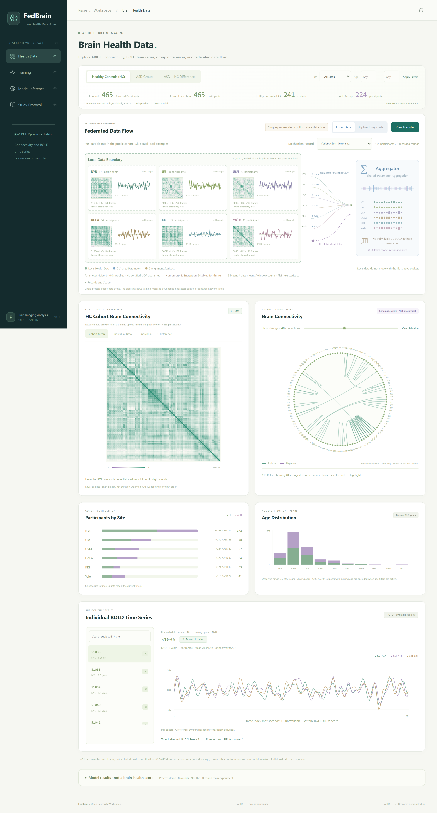
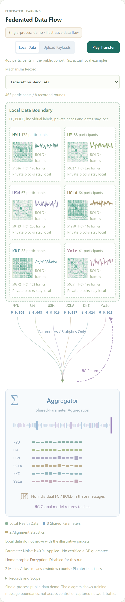

# FedBrain — Federated Brain-Network Learning

A runnable reproduction of **FedBrain: A robust multi-site brain network analysis framework based on federated learning for brain disease diagnosis** (Neurocomputing 559 (2023) 126791, [DOI](https://doi.org/10.1016/j.neucom.2023.126791)), built as a six-client federated system on real ABIDE-I data — plus the browser interface that shows, rather than claims, what the federation does with health data.

The paper reports **79%** mean accuracy. **This implementation reaches 60.8% ± 4.1 macro-site over seeds 42/43/44 and does not reproduce that result.** Numbers in this README are measured locally; the paper value is only ever shown as a separate reference.


---

## Contents

- [Why the interface exists](#why-the-interface-exists)
- [The federated part](#the-federated-part)
- [Interface](#interface)
- [Quick start](#quick-start)
- [Reproducing the experiments](#reproducing-the-experiments)
- [Measured results](#measured-results)
- [Repository layout](#repository-layout)
- [Verification](#verification)
- [Limitations and non-claims](#limitations-and-non-claims)
- [Data and citations](#data-and-citations)
- [License](#license)

---

## Why the interface exists

Most federated-learning demos show a training curve. That tells you nothing about whether data stayed put. This one is organised around the message boundary instead:

- Six real sites, each with its own functional-connectivity matrix and BOLD trace, are drawn **inside** a dashed local boundary.
- Only two kinds of object cross that boundary: the shared encoder + global head (4113 parameters), and the alignment statistics (`marginal mean`, class means, class-window counts).
- The aggregator panel shows 64 recorded parameter coordinates and the six contributions that formed them — **no individual FC, no BOLD, no subject identifiers**.
- `Play Transfer` animates one recorded round. The local charts are pinned: an automated check verifies their pixels and screen positions do not move while packets travel.
- `Upload Payloads` swaps the site panels from "what stays" to "what leaves", using the actual recorded 64-coordinate vectors, not decoration.

Everything numeric in that panel comes from `runs/federation-demo-s42`. When a value was not recorded the interface says *Not recorded* instead of inventing one — including for the 120-subject encrypted smoke run, which has no parameter trace.

## The federated part

Six sites, 465 subjects (241 HC / 224 ASD), AAL116 ROIs, CPAC `filt_noglobal` preprocessing.

| Stays at the site | Crosses the boundary | Present at the aggregator |
|---|---|---|
| Raw BOLD time series | Shared encoder + global head — **4113** parameters (16,452 bytes pre-encryption) | 6 shared-parameter uploads per round; mean taken over clients |
| 116×116 individual FC | Alignment statistics: marginal mean, class means, class-window counts (plaintext) | Only aggregate statistics; no per-subject values |
| Subject labels | Optional Paillier ciphertext of the shared vector when `--homomorphic` is set | Coordinator holds the key (see limitations) |
| Private expert head + sigmoid gate — **18** parameters per site | — | Never uploaded, never aggregated |

The full paper-module mapping lives in [docs/RESULTS.md](docs/RESULTS.md); the short version:

| Paper element | Implementation |
|---|---|
| Dynamic FC | 32-frame windows, stride 1, Pearson → Fisher-z, 6670 upper-triangle features |
| Sparse selection (Eq. 11) | Per-site shared/temporal sparse logistic with exact dual-L1 proximal step, alternating shared median; cross-site mask is the union |
| Domain alignment (Eq. 12–14) | L2 distance between marginal and class-conditional hidden means (unsquared norms, matching the paper's print) |
| MoE (Eq. 15) | Shared MLP (hidden 8) + shared global head + per-site private head, mixed by a sigmoid gate |
| Aggregation | Uniform client mean over encoder/global head only |
| Perturbation (Eq. 17) | Clip then Laplace noise on the shared vector; the actual `noise_scale` is recorded |
| Homomorphic aggregation | Real Paillier additive aggregation with fixed-point signed packing — not an encoded stand-in |

A recorded round, from the trace the interface replays:

```
round 8 · 6 clients · 292 train subjects
  local train   → private head/gate updated, shared vector computed
  upload        → clip(10.0) + Laplace(b=0.01) on 4113 params, 16,452 bytes each
  aggregate     → uniform mean; max aggregation arithmetic error 0.0
  broadcast     → private blocks verified unchanged (private_preserved = true)
                  equal-mean replay max error 2.98e-8
  alignment     → marginal / class means / window counts exchanged in plaintext
```

## Interface

Four views, all English:

| View | What it shows |
|---|---|
| **Health Data** | 116×116 FC heatmap and 116-ROI connectivity ring (HC mean, ASD mean, ASD − HC descriptive difference), cohort composition by site, age distribution, individual BOLD time series with an HC leave-one-out reference, and the federated data-flow figure |
| **Training** | Run configuration, live loss/accuracy for the selected run, per-site progress, the recorded federation replay (per-round client updates, parameter sketch, PCA of fixed training probes) |
| **Model Inference** | Per-subject connectivity and the model's output for a completed run |
| **Study Protocol** | Data processing steps, implementation transparency, paper reference, evidence and provenance |

Data exploration does not touch a checkpoint: the health views read public ABIDE derivatives directly, and accuracy appears only as a small secondary panel.

<p align="center">
  
  
</p>

Mobile layout keeps the six site panels and the boundary:

<p align="center"></p>

Optional read-only public gateway. `scripts/public_gateway.py` re-serves only GET routes through a fixed upstream and returns 403 for every write method, so a tunnel can expose the demo without exposing `/api/train`. `scripts/cloudflare_lifetime.py` wraps it with a hard expiry. This was used for a temporary 24-hour share and is **not** an authorization system.

## Quick start

Windows (PowerShell):

```powershell
git clone https://github.com/Cybermatics-prog/fedbrain-federated-brain-network.git
cd fedbrain-federated-brain-network

.\setup.ps1 -Python 'C:\Path\To\Python312\python.exe'
.\.venv\Scripts\python.exe -m fedbrain.runner download
.\start.ps1
# → http://127.0.0.1:8765
```

Any platform (Python 3.10+):

```bash
python -m venv .venv
. .venv/bin/activate          # Windows: .venv\Scripts\activate
pip install -r requirements.txt
python -m fedbrain.runner download
python scripts/build_health_data.py
python -m fedbrain.server --port 8765
```

Requirements are pinned in [requirements.txt](requirements.txt) (numpy <2, scipy, scikit-learn, torch, FastAPI, uvicorn, pydantic). A CUDA build of PyTorch is optional; the code falls back to CPU. The reference run used torch 2.11.0+cu128 on an RTX 5070 Ti.

`python -m fedbrain.runner download` fetches the ABIDE-I PCP derivatives (CPAC `filt_noglobal`, AAL116) and the phenotype table, recording a SHA-256 for every file. Roughly 2 GB of downloads and derived features; the repository ships none of it.

The interface works without any trained model: with no run directory the federation panel shows its empty state instead of fabricated values. To get the exact figure in the screenshot, reproduce the recorded demo run:

```powershell
.\.venv\Scripts\python.exe -m fedbrain.runner train --config configs/federation_demo.json --run-id federation-demo-s42
```

## Reproducing the experiments

```powershell
# 1. Link check only: 2 rounds, 120 subjects. Not a performance result.
.\.venv\Scripts\python.exe -m fedbrain.runner train --config configs/smoke.json --run-id smoke-six-sites

# 2. Main run: 50 rounds, seed 42
.\.venv\Scripts\python.exe -m fedbrain.runner train --config configs/fedbrain.json --run-id full-fedbrain-s42

# 3. FedAvg baseline on identical subjects and sparse mask
.\.venv\Scripts\python.exe -m fedbrain.runner train --config configs/fedbrain.json --method fedavg --feature-run-id full-fedbrain-s42 --run-id full-fedavg-s42

# 4. Ablations
.\.venv\Scripts\python.exe -m fedbrain.runner train --config configs/fedbrain.json --method no_alignment --run-id no-alignment

# 5. Paper evaluation protocol: 5 seeds × 5 folds per method
.\.venv\Scripts\python.exe scripts/benchmark.py --seeds 42 43 44 45 46 --folds 5 --methods fedbrain fedavg --tag repeated-cv

# 6. Bounded, paper-grounded optimization attempt (validation-selected, then locked)
.\.venv\Scripts\python.exe scripts/optimize.py --phase all

# 7. Real Paillier aggregation
.\.venv\Scripts\python.exe -m fedbrain.runner train --config configs/smoke.json --homomorphic --run-id encrypted-smoke-2048
```

Completed runs are reused rather than recomputed, and every run persists its config, subject split, preprocessing transforms, per-round validation history and a re-inference-ready checkpoint. `defer_test=true` enables strict validation-only selection: test features are not extracted and the inference API stays locked until the candidate is written to disk. Accuracy is always reported both pooled over subjects and as a six-site macro mean.

## Measured results

| Experiment | Result |
|---|---|
| Paper reference | 79% mean accuracy — **not reproduced** |
| FedBrain, seeds 42/43/44, 50 rounds (pooled / macro-site) | 59.38 / 56.89 · 61.46 / 60.41 · 67.71 / 64.97 (%) |
| FedBrain macro-site mean | **60.76% ± 4.05** |
| Matched-mask, matched-noise FedAvg, same three seeds | **63.69% ± 3.19** — the baseline is *higher*, opposite to the paper |
| Demo run, seed 42, 8 rounds (that is the trace in the UI) | test pooled 55.21%, macro-site 53.41%, AUC 0.738, sensitivity 0.128, specificity 0.959 |
| 2-round smoke, 120 subjects | test accuracy 54.17% — link check only |
| Paillier 2048-bit vs plaintext, same configuration | max prediction-probability difference 9.69e-8 |
| Bounded optimization (validation-selected, then locked) | pooled +1.03 pp, 95% interval [−5.83, +7.89] pp, **pre-registered gate not met** |

Diagnostics for why the reproduction falls short — window budget, extreme class imbalance at small sites (sensitivity 0.128 at high specificity), sparse optimization not converging in 400 steps despite a ~10.6× BLAS speed-up — are in [docs/ACCURACY_DIAGNOSIS.md](docs/ACCURACY_DIAGNOSIS.md), [docs/SPARSE_CONVERGENCE.md](docs/SPARSE_CONVERGENCE.md) and [docs/RESULTS.md](docs/RESULTS.md). Candidates were never re-selected on the test set.

## Repository layout

```
fedbrain/            # library and service
  data.py            # ABIDE download, QC, FC features, fixed windows
  model.py           # CNN encoder, MoE experts, gates, MMD-style alignment
  sparse.py          # proximal sparse selection (Eq. 11)
  federation.py      # client/server loop, recording of every event
  privacy.py         # clip + Laplace perturbation, Paillier packing
  runner.py          # training/prediction CLI and run bookkeeping
  metrics.py         # pooled and macro-site metrics
  health_data.py     # source-derived FC/BOLD store for the health views
  protection.py      # read-only description of the recorded privacy state
  server.py          # FastAPI app: data, inference, protection, health views

web/                 # dependency-free front end (no CDN)
  index.html         # four views
  app.js             # navigation, training, inference, protocol
  health.js          # health-data atlas
  protection.js      # federated data-flow figure
  federation.js      # recorded-round replay
  *.css

configs/             # run configurations (smoke, main, demo, optimization)
scripts/             # data build, benchmarking, audits, QA, packaging
docs/                # protocol, results, diagnostics, research log, figures
tests/               # 76 unit/API tests
runs/federation-demo-s42/   # the recorded 8-round trace the UI replays
```

## Verification

```powershell
.\.venv\Scripts\python.exe -m unittest discover -s tests -q     # 76 tests
.\.venv\Scripts\python.exe scripts/check_health_independent.py # health views need no checkpoint
.\.venv\Scripts\python.exe scripts/check_dataflow_invariance.py# local charts do not move during transfer
.\.venv\Scripts\python.exe scripts/check_english_ui.py         # interface text, layout, error states
```

What these cover: FC and Fisher-z correctness, window construction, cache invalidation, subject-level splits without leakage, sparse proximal accuracy, MoE/gating, alignment distances, real Paillier arithmetic, API input validation, private-expert snapshot preservation, validation checkpoint selection, test-set API lockout, per-site data independence, and the honesty rules for the interface (unrecorded values stay null; a historical run without a trace produces no parameter arrays).

Two positive controls guard the metric itself: a scorer fed ground truth scores 1.0, and 10,000 label permutations score 0.501.

## Limitations and non-claims

- **Single process, one machine.** The six clients are simulated in one Python process over centrally stored public data. Nothing here is a deployed hospital federation, and no network isolation is demonstrated.
- **Not differential privacy.** `noise_scale` is a Laplace scale `b`, not an `ε` from an accounting procedure. No formal ε-DP guarantee is claimed.
- **Paillier is arithmetic, not a security boundary.** The ciphertext addition is genuine, but the coordinator holds the private key in the same process and broadcasts the aggregated model in plaintext.
- **Alignment statistics are plaintext.** Marginal means, class means and class-window counts are not covered by the parameter noise or the Paillier path.
- **Rolling `observed` is not a proof.** Mechanism states come from configuration plus completed-round records; where a trace is missing the interface reports `unknown`.
- **Cohort differs from the paper.** 465 subjects pass this project's QC filter, while paper Table 1 lists 474 across the six sites; the author's subject list and full QC rule are not public, so counts were not forced to match.
- **Sparse optimization is not converged.** 400 steps still leaves 0/6 sites converged; lower training loss is not reported as an accuracy gain.
- **Research use only.** Not a diagnostic device; HC/ASD are source research labels.

## Data and citations

ABIDE-I PCP derivatives (CPAC `filt_noglobal`, AAL116) come from the [FCP-INDI](https://fcp-indi.github.io/) public release and are downloaded at runtime — no subject imaging data is redistributed here. The recorded demo run contains aggregate metrics, a split file and the federation trace; no subject-level images.

```bibtex
@article{zhang2023fedbrain,
  title   = {FedBrain: A robust multi-site brain network analysis framework based on
             federated learning for brain disease diagnosis},
  author  = {Zhang, Chang and others},
  journal = {Neurocomputing},
  volume  = {559},
  pages   = {126791},
  year    = {2023},
  doi     = {10.1016/j.neucom.2023.126791}
}

@article{dimartino2014abide,
  title   = {The autism brain imaging data exchange: towards a large-scale evaluation of
             the intrinsic brain architecture in autism},
  author  = {Di Martino, Adriana and others},
  journal = {Molecular Psychiatry},
  volume  = {19},
  number  = {6},
  pages   = {659--667},
  year    = {2014}
}
```

## License

Code in this repository is released under the [MIT License](LICENSE). ABIDE/CPAC data keep their own terms from FCP-INDI and are not covered by it. The article text is not redistributed.
